<div align="center">

# GridSetu

**A neighbourhood reliability reserve for India's low-income feeders, built to plug into Schneider Electric's grid, not replace it.**

Schneider Electric Yuva Yodha Energy Tech Hackathon · Challenge 03: Grid reliability and renewable intermittency

[Run it locally](#run-it-locally) · [How it works](#how-it-works) · [Results](#results) · [City-wide fleet](#city-map-and-fleet)


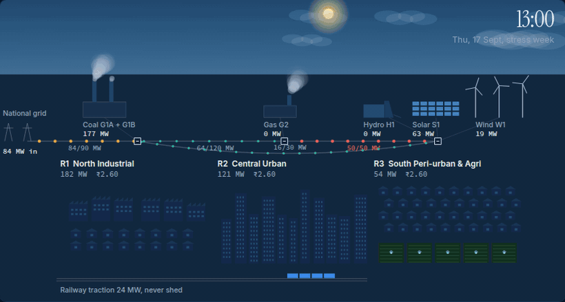

<sub>Thursday of the stress week, 13:00 to midnight. Power flows from the plants along the 220 kV ring into three districts. At 18:00 coal unit G1B trips, prices hit the ₹10 ceiling, and the DISCOM starts shedding load (amber wash, dark windows). Railways and municipal water stay on.</sub>

</div>

> **Everything here is simulation on synthetic data, not field measurement.** Every input is an engineering assumption in [`config/city.yaml`](config/city.yaml) and can be changed there.

---

## Contents

- [The problem](#the-problem)
- [What GridSetu does](#what-gridsetu-does)
- [The dashboard](#the-dashboard)
- [How it works](#how-it-works)
- [Results](#results)
  - [Who owns it, who runs it, who pays](#who-owns-it-who-runs-it-who-pays)
- [Run it locally](#run-it-locally)
- [Project structure](#project-structure)
- [Modelling assumptions](#modelling-assumptions)
- [Limitations](#limitations)
- [Roadmap](#roadmap)

---

## The problem

On a peri-urban feeder, rooftop solar fades just as the evening demand peak arrives (17:30 to 19:30). The distribution transformer overloads and trips. On a stressed grid day the DISCOM also sheds whole feeders in rotation. When that happens every home goes dark, including the health sub-centre, the school and the water pump.

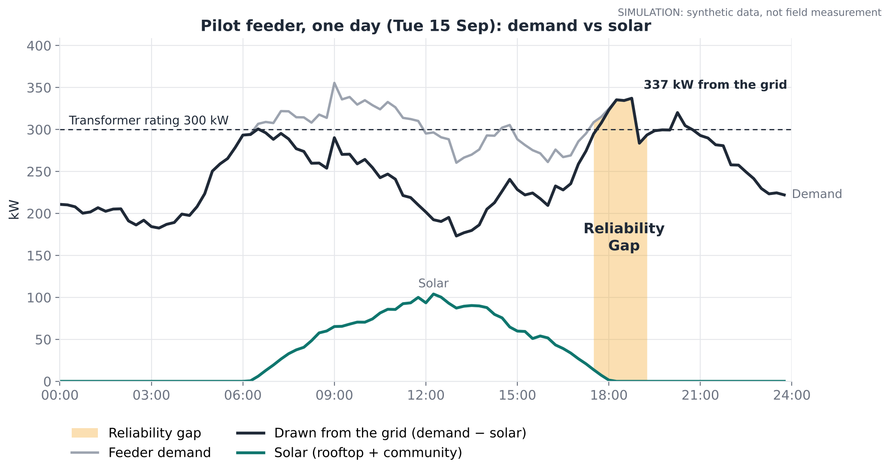

Schneider's EcoStruxure ADMS/DERMS already dispatches DERs it has a metered, contracted relationship with. A cooperatively shared community battery serving 1,090 unrelated low-income households has no single customer of record, so it never becomes dispatchable. GridSetu is the missing origination layer: it turns that feeder's shared assets into one forecasted, confidence-scored **Reliability Reserve** and publishes it to the ADMS through its own interfaces.

## What GridSetu does

| | Baseline feeder | Feeder with GridSetu |
|---|---|---|
| Evening peak | Transformer overloads and trips | Battery shaves the peak under the rating |
| DISCOM asks for relief | Whole feeder tripped in rotation | Relief delivered from battery, then Tier-3, then consented Tier-2 loads |
| Request larger than that | Feeder dark | **Lifeline:** every home's smart meter is capped at 200 W (lights, a fan, phone charging) so the request is met and nobody goes dark |
| Relief still not possible | Feeder dark | Feeder tripped, **critical loads islanded on the battery** |
| Who carries curtailment | Everyone, all at once | Rotated by a fairness ledger; no home twice in a row unless relief would otherwise fall short (10 logged intervals in the stress week) |
| What the control room sees | Nothing until it fails | A reserve with kW, duration, confidence and cost, plus a firm **call capacity** with its own confidence, updated at T−24h, T−1h, T−15min, real time and post-event |

**Load tiers on the pilot feeder**
- **Tier 1, critical:** health sub-centre, school, water pumping, street lighting. Never curtailed; islanded on the battery if the feeder trips.
- **Tier 2, important:** micro-enterprise motors. Shifted only with prior opt-in (26 of 35 workshops).
- **Tier 3, flexible:** AC boost, water heating, two-wheeler charging. Paused in 15-minute slots by the fairness ledger, and any household can override.

**Lifeline mode.** When the DISCOM's request is larger than the battery and flexible loads can give, a normal feeder is switched off and every home goes dark. GridSetu instead sets a common load limit on every home's smart meter, as low as 200 W, just low enough to meet the request. Indian prepaid smart-meter specifications already include a utility-programmable load limit with automatic disconnect and reconnect ([MSEDCL specification, following IS 16444](https://www.mahadiscom.in/supplier/wp-content/uploads/2020/05/Approved-10-60-Amp_1Ph_Prepaid_Meter_13.05.2020.pdf)). We assume 5% of limited homes exceed it and are disconnected by their meter.

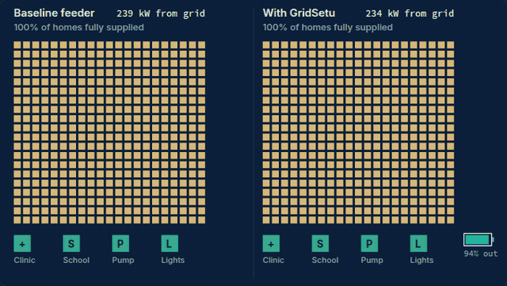

<sub>The pilot feeder's homes through Thursday evening. Left: the baseline feeder is tripped in rotation and every home goes dark. Right: GridSetu pauses Tier-3 appliances (teal outlines), rotating which homes carry it. When the DISCOM's request exceeds what the feeder can give, it is tripped too, but the clinic, school, pump and street lights stay on the battery. (Recorded with the first, 420-home model and before lifeline mode; now most of those steps keep every home on a 200 W lifeline instead.)</sub>

---

## The dashboard

A React control room over a FastAPI service. Every page is driven by one shared playhead, so scrubbing the week moves the city animation, the feeder, every chart cursor and the live readouts together.

### Control room

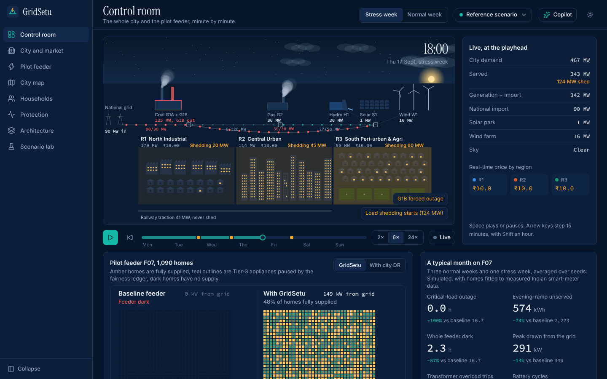

- **City scene (canvas):** plants, the 220 kV ring with moving dots whose speed and direction follow the MW, and districts whose windows go dark in proportion to the load shed in that class. The sky follows the simulated hour and cloud cover.
- **Pilot feeder inset:** all 1,090 homes side by side, baseline against GridSetu. (Screenshots were taken with the first, 420-home model.)
- **Month KPIs:** tween to their new values when a different run is selected.
- **Playback:** Space plays or pauses. Arrow keys step 15 minutes, and Shift+arrow steps an hour. Clicking any chart seeks there.

<details>
<summary><b>Light theme and phone layout</b></summary>

<br>

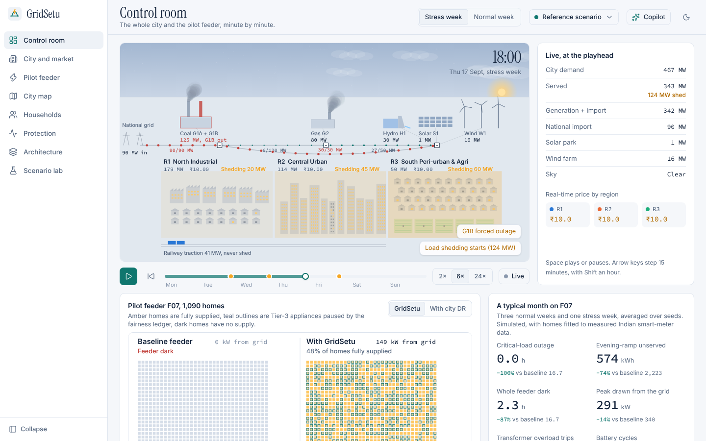 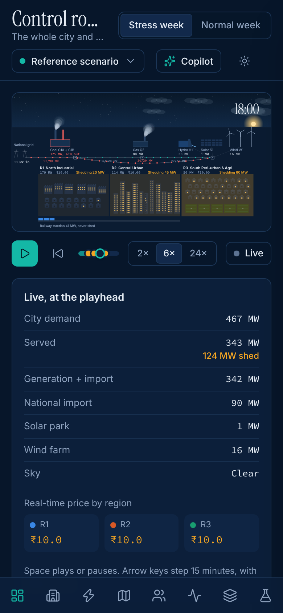

</details>

### City and market

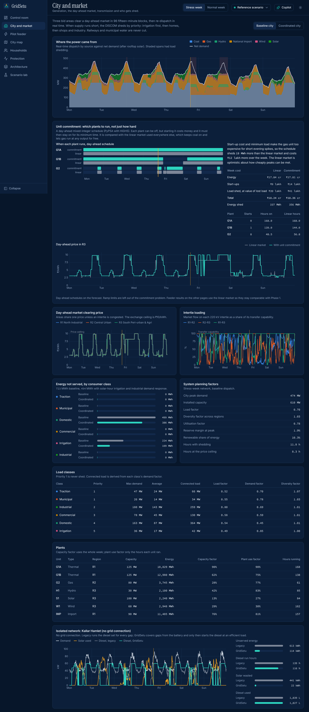

Dispatch by source against net demand, day-ahead market clearing price per bid area, intertie loading, energy not served by consumer class, and the planning tables:
- **Load classes:** load, demand and diversity factors.
- **Plants:** capacity and plant use factors.
- **Isolated microgrid:** legacy against GridSetu dispatch for the off-grid hamlet.
- **Unit commitment:** which plants run, not just how hard (below).

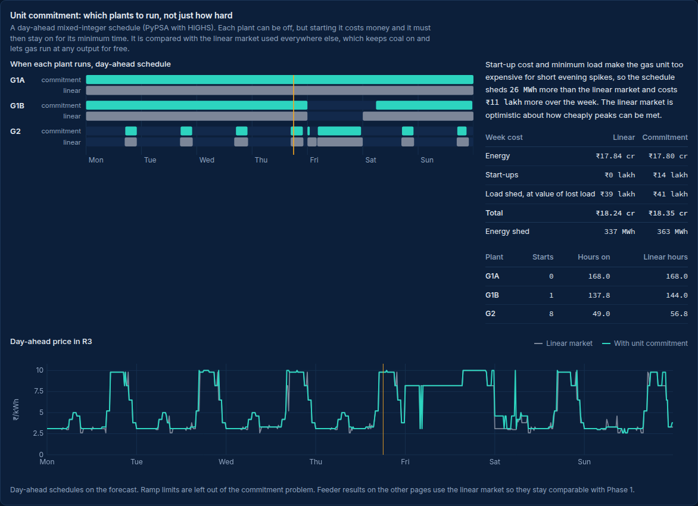

The unit-commitment card solves the day-ahead schedule as a mixed-integer problem with PyPSA and HiGHS. Plants can be switched off, but a start costs money and a started plant must stay on for its minimum time. The card compares that schedule with the linear market used everywhere else.

### City map and fleet

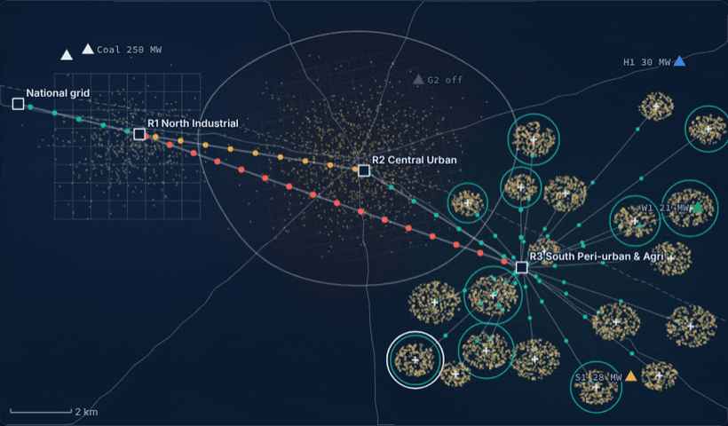

<sub>Thursday of the stress week from 16:00, with GridSetu on 10 of the 20 R3 feeders (teal rings). When coal unit G1B trips at 18:00 the DISCOM starts rotating feeders off. Feeders without GridSetu go dark with their clinic or school (red cross); GridSetu feeders either meet the request or island their critical loads (teal cross).</sub>

The pilot is one of 20 domestic feeders in R3. This page runs GridSetu on none of them, some, or all:
- **Adoption level:** 0, 25, 50, 75 or 100%. The rollout starts with overloaded transformers, then feeders with a clinic or school.
- **Map:** plants, the 220 kV lines with power flowing, R1 and R2 load zones that dim with shedding, and each R3 feeder's village. Every village shows its state at the playhead. Hover for details; click to open the feeder's week.
- **What each step buys:** critical-site hours, dark home-hours, unserved energy and overload trips at every adoption level.
- **All 20 feeders:** homes, transformer loading, critical sites, and outcomes under both controllers.

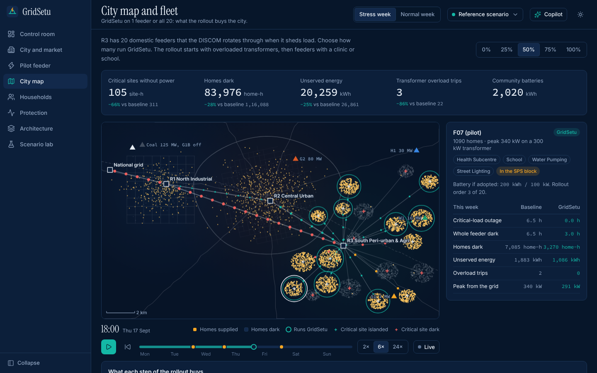 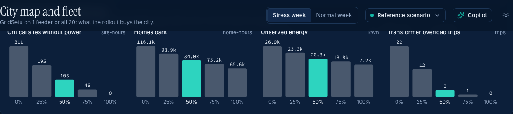

Streets are generated by default. `python -m gridsetu fetch-osm` downloads the real streets of Coimbatore's south-eastern periphery from OpenStreetMap on a machine with internet access, and the next server start draws them instead.

### Pilot feeder and the Reliability Reserve

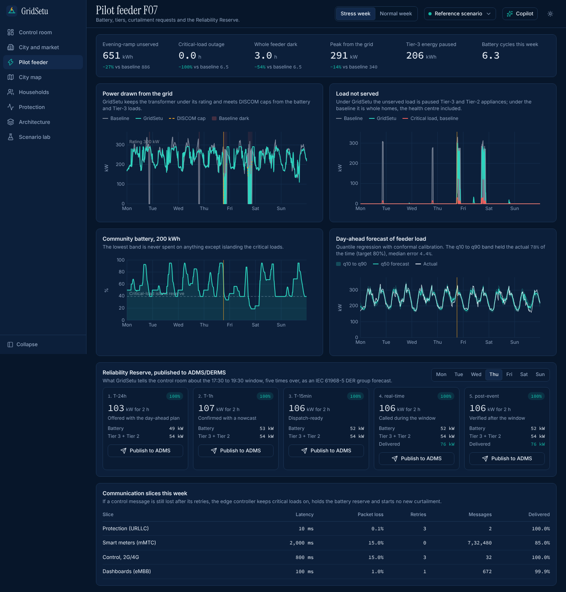

The Reliability Reserve card shows what GridSetu tells the control room about each evening window at five stages. **Publish to ADMS** posts it to a mock EcoStruxure ADMS/DERMS ingest endpoint, shaped as an IEC 61968-5 DER group forecast, and shows the acknowledgement.

### Households and fairness

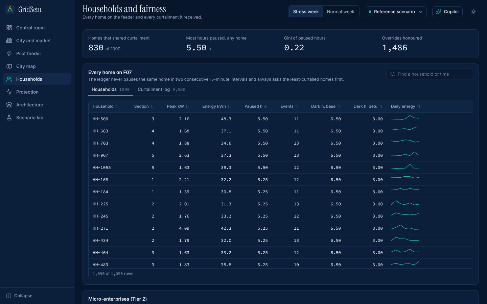

All 1,090 homes and the complete curtailment log in virtualised, sortable, searchable tables. Clicking a home opens its week as a strip: supplied, Tier-3 paused, or dark, under both scenarios.

### Protection (WAMS)

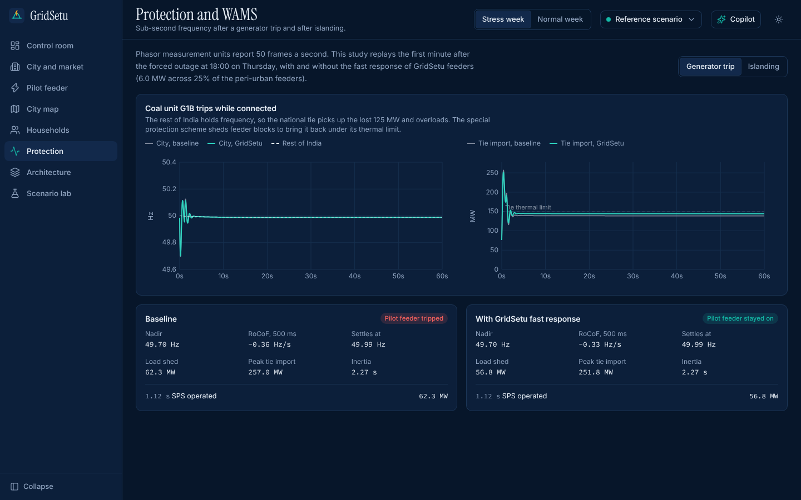

The first minute after the forced outage at 50 frames per second:
- **Case A, generator trip:** the national tie picks up the loss and the special protection scheme sheds load.
- **Case B, islanding:** the city is cut off from the national grid and under-frequency relays shed load in stages.

### Architecture and scenario lab

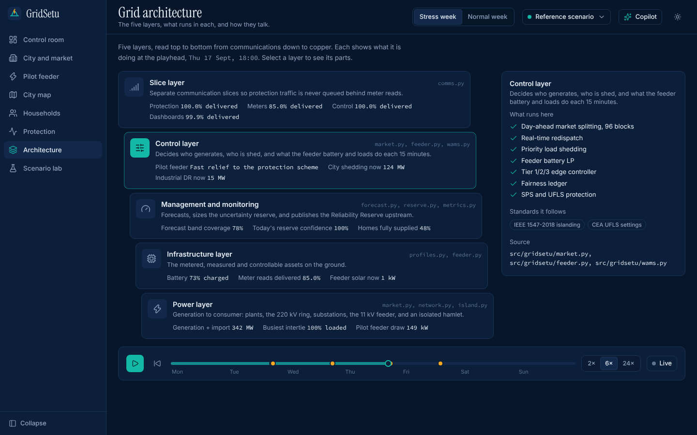 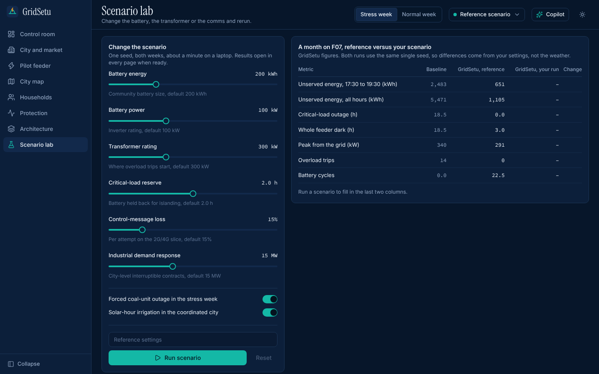

- **Architecture:** the five grid layers, each showing what it is doing at the playhead.
- **Scenario lab:** change the battery, transformer rating, critical-load reserve, control-message loss, industrial DR, the forced outage or solar-hour irrigation. The simulator reruns in about 30 seconds with live progress, and the result can be opened on every page. Lab runs use one seed, so they are compared against a one-seed reference with the same weather and loads.

### Operator copilot

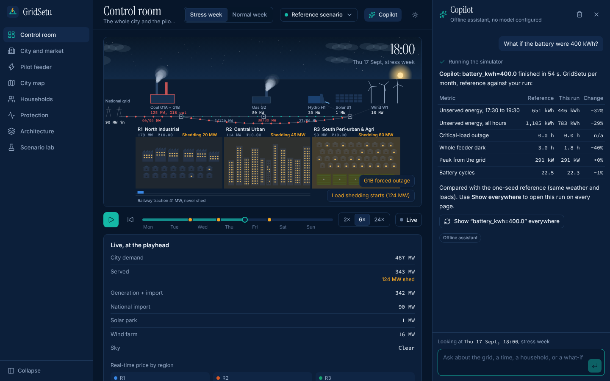

Press **Ctrl K** (or **/**) to open a chat panel docked beside the dashboard. It answers from the simulation through tools and moves the dashboard to what it is describing. Ask it:
- **What happened at a time:** "What happened at Fri 18:30?"
- **Why a price moved:** marginal unit, scarcity at the ceiling, or congestion between regions.
- **About one household:** "How was HH-042 treated?"
- **To test a change:** "What if the battery were 400 kWh?" runs the simulator and compares the result against the reference.
- **For a written note:** "Draft a note for the DISCOM about Thursday evening."

It works with four interchangeable backends, tried in this order:

| Backend | When it is used | What you need |
|---|---|---|
| **Claude** (Anthropic Messages API, tool use, streaming, prompt caching) | `ANTHROPIC_API_KEY` is set | An API key. Model via `GRIDSETU_MODEL` (default `claude-sonnet-5`) |
| **OpenAI-compatible** (any chat API with tool calling) | `GROQ_API_KEY`, `GEMINI_API_KEY`, `OPENROUTER_API_KEY` or `OPENAI_API_KEY` is set, or `GRIDSETU_LLM_BASE_URL` points at a server such as vLLM or LM Studio | A key; Groq, Gemini and OpenRouter have free tiers. Model via `GRIDSETU_LLM_MODEL` |
| **Ollama** (local model with tool calling) | No key, and Ollama is running | `ollama pull qwen2.5:7b-instruct`. Model via `GRIDSETU_OLLAMA_MODEL` |
| **Offline** (rule-based, no model) | None of the above | Nothing. It understands a fixed set of questions |

Put keys in a `.env` file in the project folder; [`.env.example`](.env.example) lists every setting. Force a backend with `GRIDSETU_COPILOT=claude|openai|ollama|offline`. Whichever backend runs, every figure in an answer comes from a tool call. The model never computes or estimates numbers itself.

### Live telemetry replay


**Live** in the playback bar makes the server replay the run as the messages a control room would receive, and the server drives the playhead. Each 15-minute interval carries:
- F07 SCADA: state, import, battery power and state of charge.
- Smart-meter reads, after mMTC packet loss.
- City state: demand, shedding, prices.
- Reliability Reserve publications.

Set `GRIDSETU_MQTT=host:1883` and the same messages are also published to an MQTT broker. Or publish without the dashboard:

```bash
python -m gridsetu replay --broker 127.0.0.1:1883 --start "Thu 17:00" --speed 4
# topics: gridsetu/<run>/city/state, gridsetu/<run>/feeder/F07/{scada,ami,reserve}
```

---

## How it works

### Grid architecture

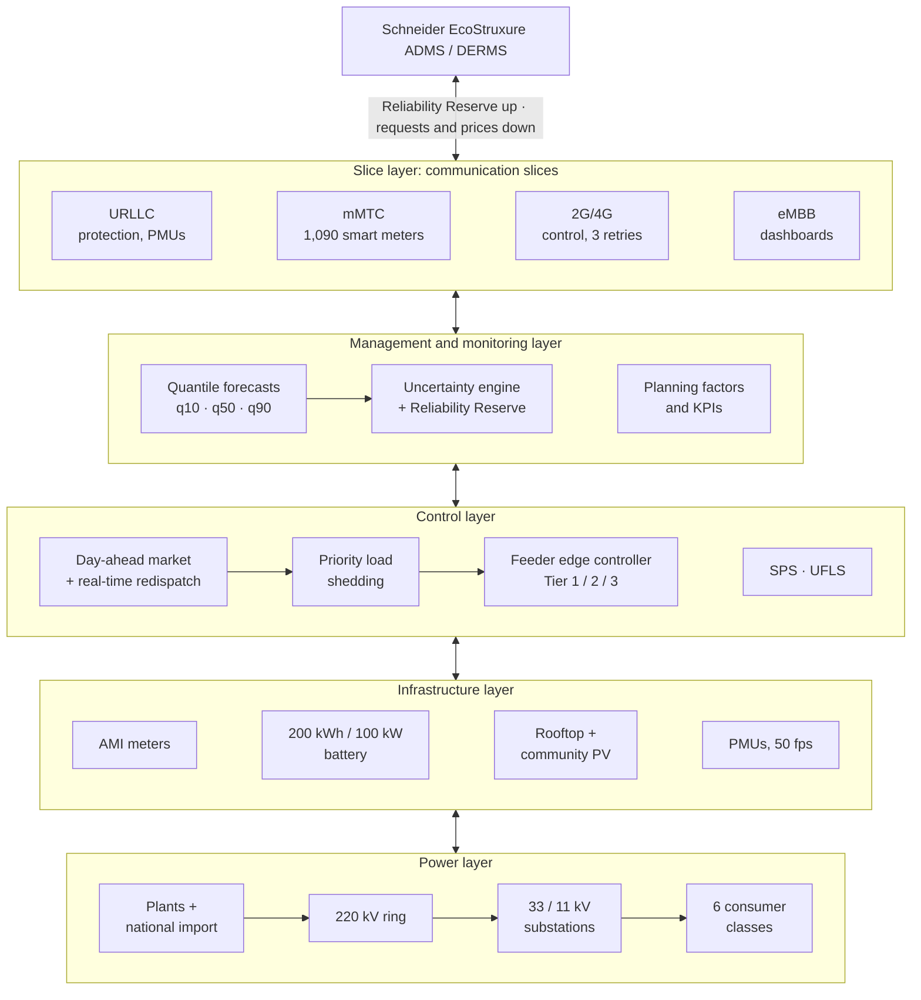

### How power reaches a home

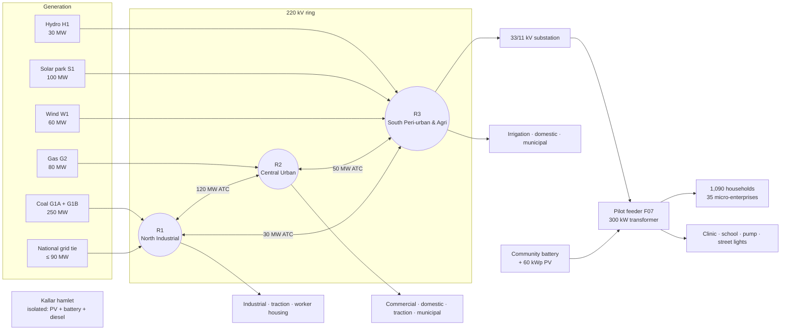

### One simulated week

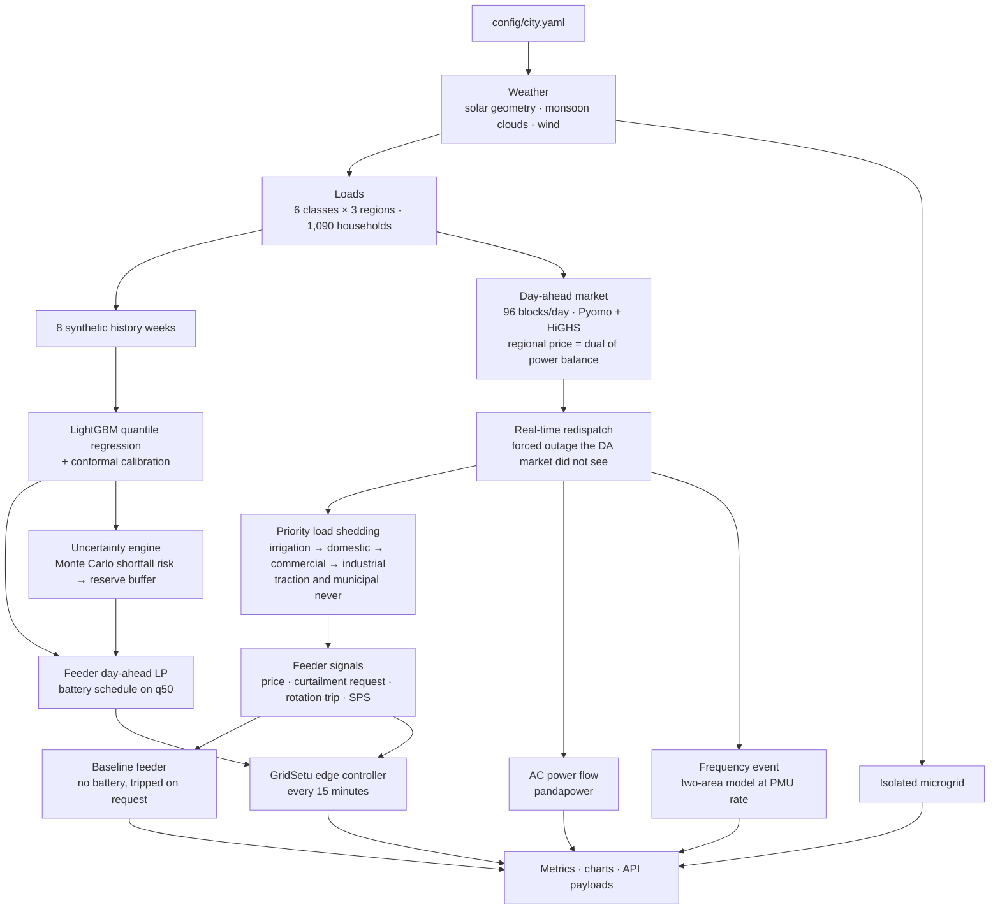

### The edge controller, every 15 minutes

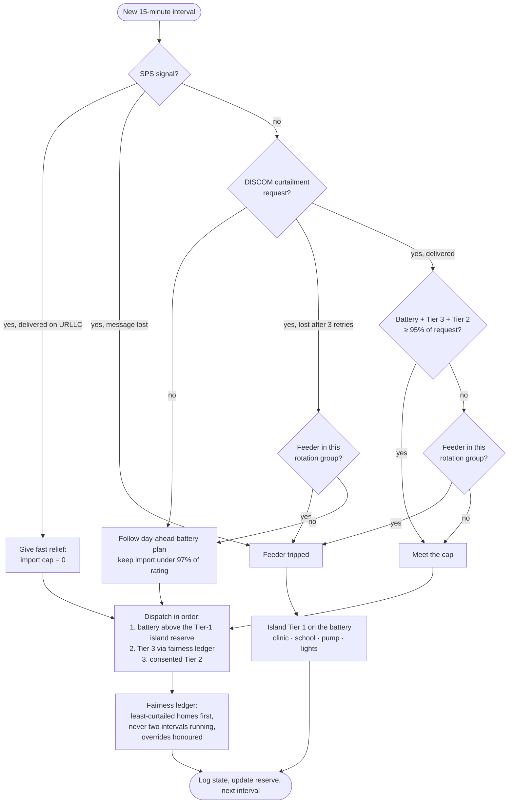

### Reliability Reserve lifecycle

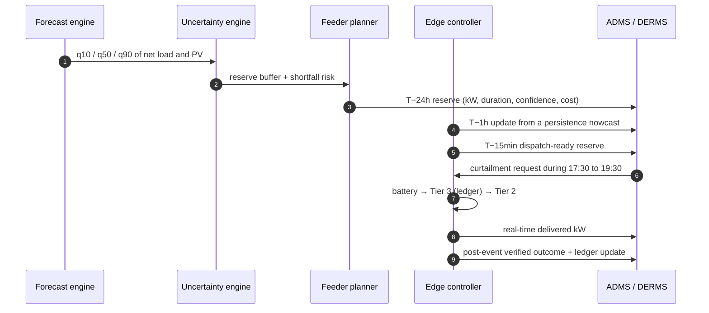

### A copilot turn

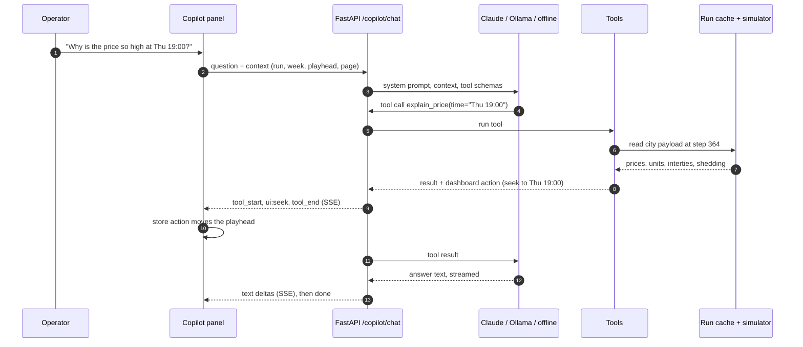

### The fleet study

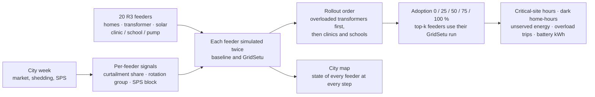

A DISCOM request is always a share of a feeder's own load, and a GridSetu feeder that cannot meet it is tripped like any other. No feeder can push its burden onto a neighbour, so each feeder's two runs can be combined freely into any adoption level.

### Front-end data flow

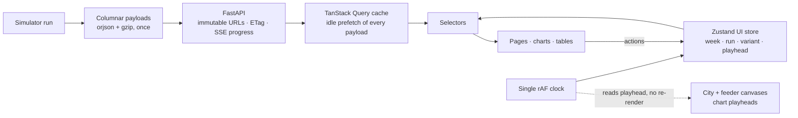

Data flows one way. The server payloads are immutable, so each is fetched once and every week or page switch after that is served from the cache. The canvases and chart playheads read the clock outside React; React re-renders only when the playhead crosses a 15-minute step. Measured playback in headless Chromium held a steady 16.7 ms per frame.

---

## Results

Monthly composite of three normal weeks and one stress week (a forced 125 MW coal outage and two overcast monsoon days), averaged over three weather and load seeds.

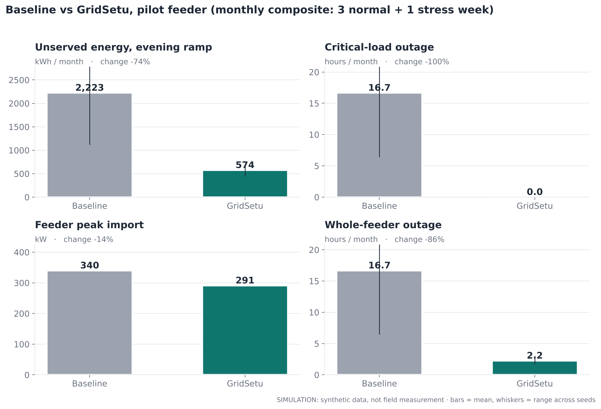

| Metric, per month | Baseline | GridSetu | Change | + city DR |
|---|--:|--:|--:|--:|
| Unserved energy, 17:30 to 19:30 | 2,223 kWh | 574 kWh | −74% | 461 kWh |
| Unserved energy, all hours (net of rebound) | 4,913 kWh | 907 kWh | −82% | 599 kWh |
| Critical-load outage | 16.7 h | 0.0 h | −100% | 0.0 h |
| Whole-feeder outage | 16.7 h | 2.2 h | −86% | 1.2 h |
| Homes fully without supply | 18,167 home-hours | 2,483 home-hours | −86% | 1,298 home-hours |
| Homes on the 200 W lifeline instead | – | 1,002 home-hours | | 1,204 home-hours |
| Transformer overload trips | 13 | 0 | −100% | 0 |
| Peak drawn from the grid | 340 kW | 291 kW | −14% | 291 kW |
| Battery cycles | – | 23.0 | | 22.8 |

The feeder has 1,090 homes whose load is fitted to measured Indian smart-meter data (see "Our homes against real Indian homes"). *+ city DR* adds city-level solar-hour irrigation and 15 MW of industrial demand response. Seed ranges: baseline evening unserved energy 1,124 to 3,062 kWh; GridSetu 445 to 651 kWh.

**Other studies (stress week)**
- **Fairness:** 842 of the 1,090 homes had a Tier-3 appliance running while curtailment was needed, and 830 of them shared it, at most 5.5 hours each. Gini of paused hours among those homes 0.22, with 1,486 user overrides honoured. The other homes had nothing to pause, so they were never asked.
- **Forecast:** the q10 to q90 band covered the actual net load 78% of the time (nominal 80%), with a median error of 4.4%. The band is calibrated on all eight history weeks (cross-conformal) and then adjusts itself each day to the misses of the day before (adaptive conformal inference); before this change it covered 72%. The published reserve still uses its own, more cautious bound and held every evening (see below).
- **City:** energy not served fell from 723 MWh to 494 MWh with solar-hour irrigation and industrial DR. Traction, municipal, commercial and industrial loads were never shed.
- **Protection:** in Case A the frequency nadir was 49.70 Hz and GridSetu's fast response cut special-protection shedding from 62 to 57 MW. In Case B (islanding) the nadir was 49.16 Hz, with two under-frequency stages operating.
- **Isolated microgrid:** unserved energy fell from 613 to 114 kWh per week, diesel run hours from 139 to 116, and wasted solar from 441 to 22 kWh.
- **AC power flow:** the most-loaded 220 kV line peaked at 110% of its thermal rating in 8 samples during the outage. Voltages at the 33 kV substation buses stayed within 0.99 to 1.03 pu (the low-voltage network is covered by the MATLAB model below).
- **Planning factors:** city peak 474 MW, load factor 0.70, reserve margin at peak 1.9%.

### City-wide fleet (Phase 2)

All 20 R3 domestic feeders (about 22,000 homes; 18 of 20 transformers overloaded at the evening peak), totals for the stress week, seed 42:

| GridSetu on | Critical-site hours dark | Home-hours dark | Unserved energy | Overload trips | Batteries |
|---|--:|--:|--:|--:|--:|
| 0 of 20 feeders | 311 | 116,088 | 26,861 kWh | 22 | – |
| 5 (25%) | 195 | 98,940 | 23,349 kWh | 12 | 1,040 kWh |
| 10 (50%) | 105 | 83,976 | 20,268 kWh | 3 | 2,020 kWh |
| 15 (75%) | 46 | 75,243 | 18,845 kWh | 1 | 3,020 kWh |
| 20 (100%) | 0 | 65,554 | 17,182 kWh | 0 | 4,080 kWh |

- **Critical loads:** the first quarter of the rollout removes over a third of the critical-site outage hours, because it targets the most overloaded feeders with clinics first. Full adoption removes all of them.
- **Homes dark:** falls by 44% at full adoption in the stress week. The 30-hour generation shortfall is larger than feeder batteries can cover. Lifeline caps homes at 200 W instead of rotating them off, but real homes already draw little in the evening, so capping frees less than our first, heavier homes suggested (−75% with them).
- **Normal week:** at 75% adoption no home is dark at all (45,424 home-hours at 0%), because transformer overload trips, the main cause of outages in a normal week, disappear.

### Unit commitment study

A day-ahead mixed-integer schedule (PyPSA with HiGHS) against the linear market, stress week:
- **Coal stays on all week.** Stopping a coal unit overnight saves less than its ₹9 lakh restart.
- **Gas is started 8 times** for evening peaks and runs 49 hours, against 57 in the linear market.
- **Peaks cost more than the linear market assumes.** A ₹60,000 start and a 20 MW minimum load make the gas unit too expensive for short spikes, so the schedule sheds 26 MWh more (363 against 337 MWh) and costs ₹11 lakh (0.6%) more. A tighter solver gap does not change this. Flexible demand, such as a GridSetu reserve, is worth more than the linear market suggests.

Feeder results use the linear market so they stay comparable with Phase 1.

**Where the model disagrees with earlier estimates**
- **Solar utilisation:** the earlier figure of 61% to 84% is not supported. Daytime load on this feeder always exceeds its 150 kWp of solar, so both scenarios already use about 100% of it.
- **Stress events:** during a 30-hour, 125 MW shortfall a 200 kWh battery cannot supply all the relief requested. Lifeline covers most of the gap, but on the largest requests the feeder is still switched off for a few 15-minute steps, with its critical loads kept on.
- **Frequency support:** about 6 MW of fast response from a quarter of the peri-urban feeders is real but small at city scale. Fairness and critical-load protection are the stronger results.

### Does the Reliability Reserve keep its word?

Every evening GridSetu publishes a reserve with a confidence. We checked all 1,260 published forecasts (30 seeds × 2 weeks × T−24h, T−1h and T−15min) against what actually happened. Run it with `python -m gridsetu calibrate --seeds 30`.

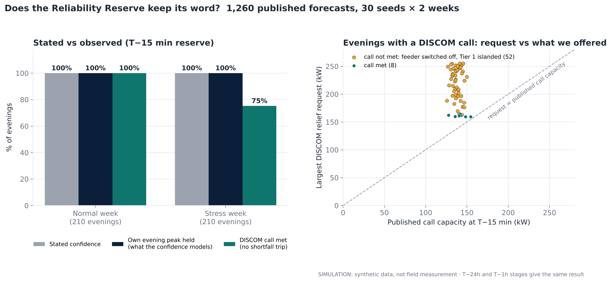

- **What the confidence covers, it delivers.** The published confidence is the chance of holding the feeder's own evening peak under the transformer limit. It said 100% every time, and the peak was held on every evening in both normal and stress weeks.
- **The DISCOM's call needs its own promise.** On 60 evenings (two per stress week, after the coal unit trips) the DISCOM asked this feeder for relief, at 1.6 to 4.5 times the published reserve (median 2.4 times). The first version of GridSetu met none of these calls. So the reserve now carries a second number: a firm **call capacity** (battery spread over the evening, consented Tier 2, and what lifeline can free) with a **call confidence** of 90%.
- **With calls as the DISCOM makes them today** (its full share of the shortage, not what we offered), requests were a median 2.15 times our call capacity, and the feeder met 0 of 60 calls in full. On those evenings it was switched off for part of the evening, with the clinic, school and pump on the battery. A shared battery cannot carry a city-wide generation shortfall on its own; it can carry what it promises.
- **With calls bounded by the day-ahead offer**, as in an ADMS/DERMS dispatch contract, the call was met on 53 of 60 evenings. The 90% call confidence held 90.8% of the time over 153 forecasts: the promise is honest. Run it with `python -m gridsetu calibrate --seeds 30 --bounded-calls`.

### Losses, voltage and transformer ageing (MATLAB low-voltage model)

The simulator above treats the feeder as one point, so it cannot see losses or voltage along the wires. [`matlab/run_f07.m`](matlab/) places the same loads on a radial 415 V network (3 circuits × 7 buses, ACSR Rabbit, a 315 kVA IS 1180 Level-2 transformer; every parameter and its source in [`matlab/f07_params.json`](matlab/f07_params.json)). It solves a load flow for every 15-minute step and runs the IEC 60076-7 transformer thermal model. A Python twin (`python -m gridsetu lv-study`) gives the same answer at every step, to within 10⁻⁸.

| Stress week | Baseline | GridSetu, battery at the transformer | GridSetu, storage split across the 3 circuits |
|---|--:|--:|--:|
| Technical losses (lines + transformer) | 4,411 kWh | 4,480 kWh | 4,203 kWh |
| Voltage violations (±6 %) | 1,869 bus-hours | 1,896 bus-hours | 1,838 bus-hours |
| Peak transformer loading | 1.37 pu | 1.20 pu | 1.15 pu |
| Peak transformer hot-spot | 89.0 °C | 83.4 °C | 82.1 °C |

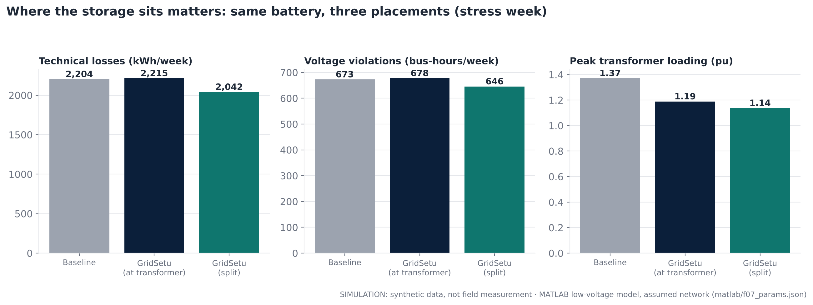

- **GridSetu protects the transformer.** Peak loading falls from 1.37 to 1.20 pu and the hot-spot peak by about 5.5 °C.
- **A battery at the transformer cannot cut line losses or voltage drop.** The current on the wires to the homes is the same either way, so technical losses barely move (they rise 2%, because GridSetu serves more energy and recharges the battery over the same wires).
- **Where the storage sits matters.** The same battery split across the middle of each circuit cuts technical losses by about 5% and lifts the worst voltage from 0.79 to 0.80 pu. This is now the recommended layout.
- **Voltage stays outside limits on the assumed network in every case.** Long, heavily loaded LT circuits are the cause; GridSetu's bus-level voltage map shows the DISCOM exactly where reconductoring would pay off.

### The critical bus at millisecond resolution (Simulink)

Everything above works in 15-minute steps. [`matlab/islanding/`](matlab/islanding/) builds a Simulink model of the moment the feeder trips at 18:45 and runs it at 0.1 ms steps (`run_islanding` in MATLAB). Battery inverter, island switch and critical loads are modelled as an average-value circuit with assumed, marked settings.

- **The feeder trips at 1.0 s.** We modelled two inverter designs:
  - *Inverter following the grid, ordinary island switch:* the voltage falls to 0.55 pu, loss of grid is confirmed after 40 ms and the tie opens after 100 ms. The lights flicker, but this is outside the ITIC curve for sensitive electronics.
  - *Inverter always grid-forming, static transfer switch (recommended):* the inverter holds the voltage up to its current limit (0.34 pu with the whole feeder on it) and a thyristor switch separates the critical bus within 4 ms (ABB's published sense-plus-transfer time). The bus is below 0.7 pu for 12 ms and below 0.9 pu for 23 ms, **within the ITIC curve**, so clinic equipment rides through without a UPS.
- **The water pump starts in the island.** Five times its rated current dips the voltage to 0.965 pu and the frequency to 49.84 Hz; secondary control brings it back to 50 Hz.
- **The grid returns 115° out of phase.** The island speeds up by 0.3 Hz to catch the grid's phase and closes the tie only within 10° and 0.1 Hz, at 6.94 s. The battery then ramps back to its 90 kW evening dispatch.
- **Baseline:** the critical bus is dark for the whole outage.
- **What it costs:** the recommended design needs a grid-forming inverter and a static transfer switch; their extra cost is not yet in the business case and needs a vendor quote.

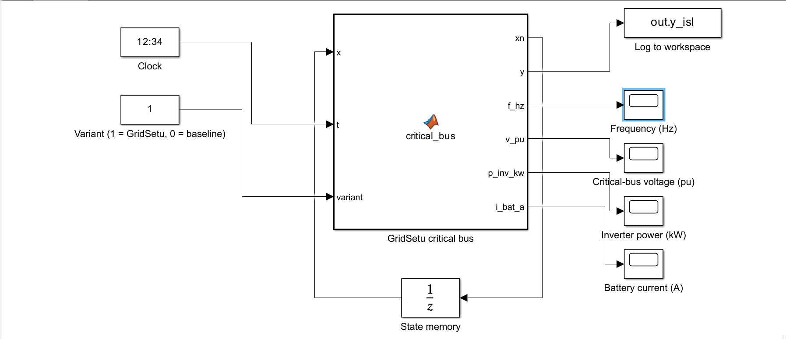

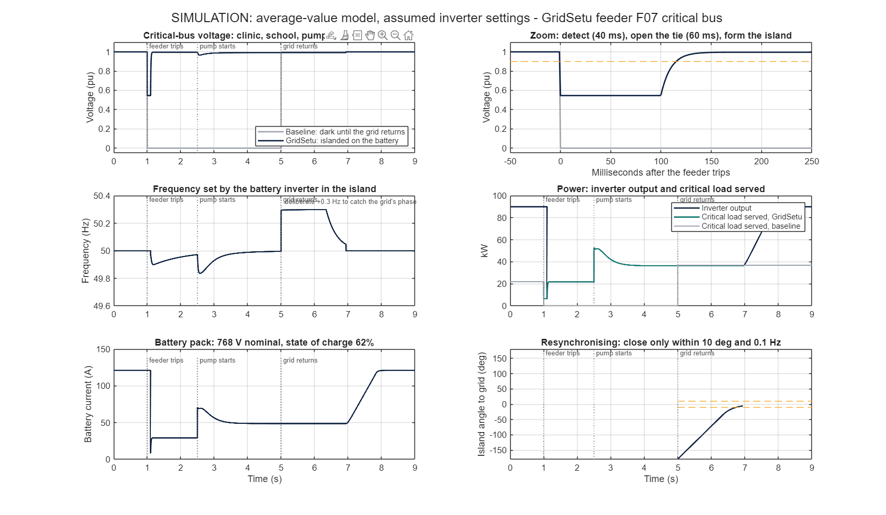

The Simulink model is generated by code (`build_islanding_model.m`), and `run_islanding` checks it against the same equations run as a plain loop: in MATLAB R2025a the two agree exactly (largest difference 0). Details in [`matlab/README.md`](matlab/README.md).

### Checked against real weather and real prices

The scenario is synthetic, so we tested its two most important outside inputs against real data for the same calendar dates in 2025 (`python -m gridsetu real-data`, results in `outputs/real_data/`; sources and checks in [`docs/DATA_CARD.md`](docs/DATA_CARD.md)):

- NASA POWER hourly sunshine and temperature for Coimbatore, 20 Jul to 21 Sep 2025.
- IEX day-ahead clearing prices for 14–20 Sep 2025, all 672 fifteen-minute blocks.

Household load stays synthetic (fitted to measured homes) in every case.

**Prices: the real evening is harsher than our curve.** Real prices reached the ₹10/kWh exchange ceiling on 6 of 7 days, for most of the evening. Our curve stops at ₹9.8 and never reaches it. Midday is far cheaper than we assumed: the real 10:00–16:00 average was ₹1.17/kWh, against our ₹2.6. Both points strengthen the case for storing cheap solar-hour energy for the evening.

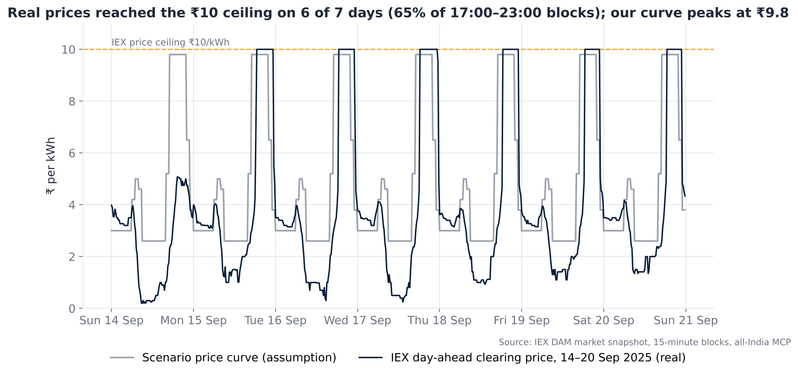

**Weather: real monsoon sunshine is lower and steadier than ours.** Over the 63 days, real sunshine averaged 4.13 kWh/m²/day against 5.15 kWh/m²/day in our synthetic weather. Our weather has too many bright days and a few darker ones; part of the gap is that NASA's clear-sky sunshine, which includes Indian aerosol levels, is about 13% below our clear-sky model.

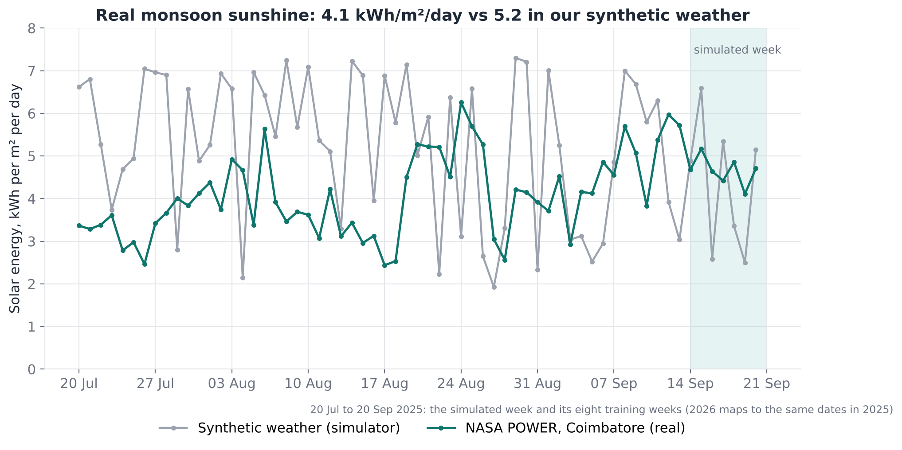

**Forecast backtest on real weather.** The forecaster was trained on six weeks and tested on the next, for three test weeks. On real weather, with only yesterday's weather as the weather forecast, the actual net load fell inside the 80% range 79.2% of the time, against 78.0% on synthetic weather. Real weather costs the forecast nothing, and the self-adjusting band now sits close to its 80% target on the spiky fitted homes.

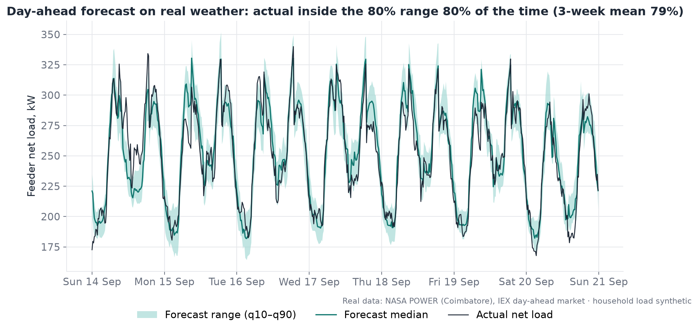

**The stress week re-run on real inputs** (same grid outage, evening unserved energy on feeder F07, one week):

| Inputs | Baseline | GridSetu |
|---|--:|--:|
| Synthetic weather and prices (as in the results above) | 886 kWh | 651 kWh |
| Real weather | 800 kWh | 465 kWh |
| Real weather and real IEX prices | 809 kWh | 513 kWh |

Our synthetic stress week forces two deeply overcast days; the real week of 14–20 September 2025 had none, so GridSetu does better on it. The critical loads stay powered in all three cases. We keep the harsher synthetic week for the headline figures.

### Our homes against real Indian homes

Household load is the biggest synthetic input, so we compared it with measured data (`python -m gridsetu household-check --sensitivity`). Two sources:

- Prayas Energy Group's eMARC smart-meter data: 116 homes in Maharashtra and Uttar Pradesh, 2018–2020, 15-minute load, public domain ([Harvard Dataverse](https://dataverse.harvard.edu/dataset.xhtml?persistentId=doi:10.7910/DVN/YJ5SP1)). We processed all 6.1 million main-line readings.
- Tamil Nadu's domestic average: 30,602 million units over 23.9 million connections in 2022-23 ([TN DES](https://des.tn.gov.in/sites/default/files/2025-07/10.%20ELECTRICITY.pdf)).

**Our first homes were too heavy and too synchronised, so we refitted them.** The first model gave each of 420 homes 8.6 kWh a day, nearly twice a measured Indian home, and all of them peaked at the same moment. The household model now used is fitted to eMARC: each home follows the measured daily shape, scaled by its own size, with random appliance bursts on top (a quarter of its energy, about 0.8 kW for about 75 minutes). The feeder's 340 kW is anchored at the evening peak, so the same transformer now serves 1,090 homes.

| Per home | First model (420 homes) | Fitted model (1,090 homes, now used) | Measured Indian home, Aug–Oct |
|---|--:|--:|--:|
| Daily energy | 8.6 kWh a day | 4.9 kWh a day | 4.6 kWh a day (Tamil Nadu average 3.5 kWh a day) |
| Median home's daily energy | 8.3 kWh | 3.2 kWh | 4.1 kWh |
| Evening load, 17:30–19:30 | 0.56 kW | 0.22 kW | 0.21 kW |
| Evening load above the 200 W lifeline floor | 64% | 44% | 37% |
| Coincidence (peak of the average ÷ average of each home's peak) | 0.85 | 0.30 | 0.35 |

The fitted homes match measured energy, evening load and diversity closely. The remaining gaps: the median home is too light (3.2 against 4.1 kWh), so our homes are slightly more unequal than real ones, and a little more of their evening load sits above 200 W.

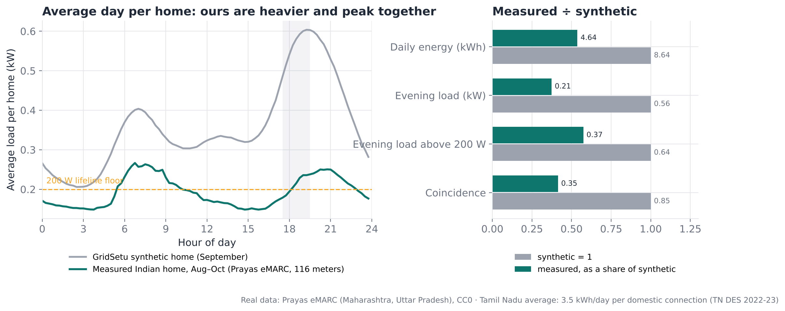

**What changed in the results** (monthly, both models with the same feeder peak):

| | First model, 420 homes | Fitted model, 1,090 homes |
|---|--:|--:|
| Evening unserved energy, baseline → GridSetu | 2,713 → 482 kWh | 2,223 → 574 kWh |
| Home-hours fully dark, baseline → GridSetu | 5,740 → 291 | 18,167 → 2,483 |
| Whole-feeder outage with GridSetu | 0.5 h | 2.2 h |
| Critical-load outage with GridSetu | 0 h | 0 h |

The core results hold on realistic homes: the clinic, school and pump never go dark, overload trips disappear, and evening unserved energy falls by about three quarters. Lifeline helps less than the first model suggested, because real homes already draw little in the evening, so capping them at 200 W frees less power. The headline figures above all use the fitted model.

### What it costs, and when it pays

`python -m gridsetu economics` prices the pilot feeder for a year (13 stress weeks and 39 normal weeks, matching the headline month), with the real IEX prices and a battery cost from the market: the 2025 Indian benchmark tariff for 2-hour storage, ₹2.3 lakh per MW per month ([IEEFA–JMK, 2026](https://www.ess-news.com/2026/05/19/india-awards-10-4-gw-of-standalone-bess-capacity-in-2025-but-tariff-viability-remains-a-concern/)). That tariff already covers capital, maintenance and return; we double it because a 100 kW unit costs more per MW than a 250 MW tender.

| Per year, one feeder | ₹ |
|---|--:|
| Battery (benchmark tariff × 2) | 5.52 lakh |
| Smart plugs for Tier 3 (₹1,500 a home, 5-year life) | 3.27 lakh |
| Edge controller and comms | 0.25 lakh |
| **Total** | **₹9.0 lakh a year**, or ₹69 per home per month |
| Extra energy bought for the outages avoided (at IEX prices) | 2.24 lakh |

GridSetu avoids 52,081 kWh of outage a year. So it pays for itself if an avoided outage is worth more than **₹21.7 per kWh** to the community:

- Valued at the IEX price ceiling (₹10/kWh), it does not: benefit ÷ cost is 0.46.
- Valued at what diesel backup costs (₹99.55 a litre in Chennai, about ₹33/kWh), it does: benefit ÷ cost is 1.53.
- The battery's price matters most: at utility-scale cost the break-even falls to about ₹16/kWh, at three times it rises to about ₹27/kWh. Smart plugs come next: every home in the model has some Tier-3 load, so every home gets one, though only about 41% of measured homes own an AC or water heater.

GridSetu does not lower the average price paid for each kWh (₹4.00 in both cases), because it serves more energy in the expensive evening. Its value is reliability, not arbitrage.

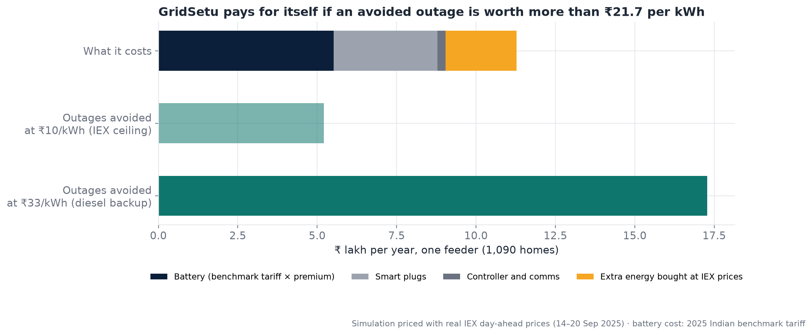

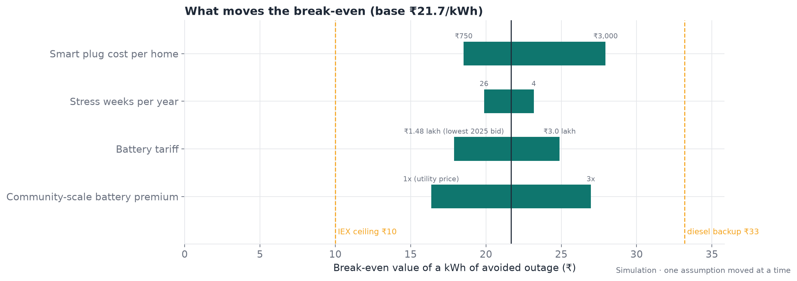

### Who owns it, who runs it, who pays

Full model, roles and maintenance plan: [`docs/OWNERSHIP.md`](docs/OWNERSHIP.md). Computed by `python -m gridsetu ownership`.

- **Allowed:** the Electricity (Amendment) Rules, 2025 let a DISCOM, an independent storage service provider or a consumer own or operate a battery and sell, lease or rent its capacity.
- **Recommended model:** the DISCOM buys feeder reliability as a service. A local operator (a small energy-service company or a cooperative) owns the battery and is paid a fixed monthly availability fee: the same contract form as India's 2025 utility battery tenders. A trained local operator, for example from a women's self-help group, does the daily checks and runs the help desk. The residents' committee sets the fairness rules and hears complaints. The battery vendor holds the maintenance contract.
- **Who pays:** the DISCOM pays ₹6.73 lakh a year (battery, controller, local operator); the smart plugs are a one-off grant of ₹16.4 lakh (state scheme or company CSR). **Homes pay nothing extra.**
- **What the DISCOM gets back:** a ₹20.0 lakh transformer upgrade put off (₹1.90 lakh a year) and fewer technical losses (₹0.43 lakh a year). Its net cost is ₹4.40 lakh a year, **₹8.45 per kWh of outage avoided**.
- **Affordable?** The whole cost is ₹76.5 per home per month. Tamil Nadu's May 2026 move from 100 to 200 free units per bill costs about ₹99 per benefiting home per month; GridSetu costs less and buys reliability, not units.

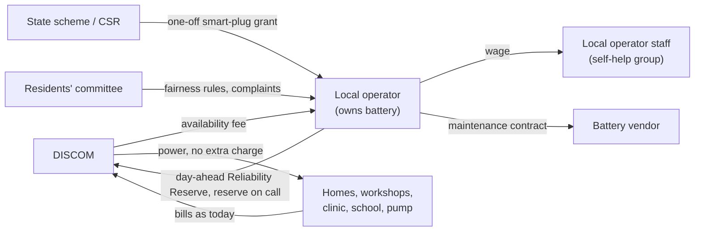

---

## Run it locally

**Requirements:** Python 3.11 or newer (`requirements-lock.txt` is verified on Python 3.13), Node 20 or newer. About 2 GB of RAM; no GPU needed.

```bash
git clone https://github.com/HUNT-001/gridsetu.git
cd gridsetu
python -m venv .venv && source .venv/bin/activate     # Windows: .venv\Scripts\activate
pip install -r requirements-lock.txt     # exact versions; requirements.txt has ranges

# build the dashboard once
cd web && npm install && npm run build && cd ..

# optional: copilot keys (Claude, or a free Groq / Gemini / OpenRouter key)
cp .env.example .env                                  # then edit .env

# start the API and the dashboard
python -m gridsetu serve                              # http://127.0.0.1:8000
```

The first start simulates the reference scenario (3 seeds, plus the 20-feeder fleet and unit-commitment studies, about 4 minutes) and caches it in `.cache/runs/`. Later starts are instant.

| Command | What it does |
|---|---|
| `python -m gridsetu serve` | API plus built dashboard on port 8000 |
| `python -m gridsetu run --seeds 3` | Batch study: charts, CSVs and `outputs/summary.txt` |
| `pytest -q` | 73 tests: physics and safety invariants, unit commitment, the fleet and the map, copilot tools, the Claude and OpenAI-compatible tool loops, offline answers and replay |
| `python -m gridsetu calibrate --seeds 30` | Checks every published reserve confidence against the outcome (about 14 minutes on 2 cores) |
| `python -m gridsetu numbers --check README.md` | Rebuilds `outputs/numbers.json` and fails if the README quotes a figure that no longer matches |
| `bash scripts/reproduce.sh` | Re-runs the full study and fails if any committed result changes by more than one part in a billion (install `requirements-lock.txt` first) |
| `python -m gridsetu lv-study` | Low-voltage network study (Python twin of the MATLAB model) and its charts, in `outputs/lv/` |
| `matlab/run_f07.m`, `matlab/make_figures.m` | The MATLAB low-voltage model and its charts (MATLAB R2019b+ or GNU Octave 7+, no toolboxes) |
| `python -m gridsetu household-check` | Our synthetic homes against measured Indian homes; `--sensitivity` re-runs with 720 and 1,030 homes (about 10 minutes) |
| `python -m gridsetu economics` | Rupee business case at real IEX prices, in `outputs/economics/` (about a minute) |
| `python -m gridsetu real-data` | Checks the scenario against real weather (NASA POWER) and real prices (IEX), in `outputs/real_data/` (about 40 seconds) |
| `python -m gridsetu export-matlab` | Writes per-bus load profiles of feeder F07 for the MATLAB low-voltage model (`outputs/matlab/`) |
| `python -m gridsetu fetch-osm` | Download real OpenStreetMap streets for the city map (`--bbox south,west,north,east` to choose the area) |
| `python -m gridsetu replay --broker host:1883` | Publish a run as live telemetry to MQTT |
| `cd web && npm run dev` | Dashboard with hot reload on port 5173, with the API proxied |
| `cd web && npm run build:demo` | One self-contained HTML file with a data snapshot, for sharing without a server |

**API**

| Route | Returns |
|---|---|
| `GET /api/v1/runs` | Runs and their status |
| `POST /api/v1/runs` | Starts a scenario-lab run from `{"knobs": {...}}` |
| `GET /api/v1/runs/{id}/progress` | Live progress as Server-Sent Events |
| `GET /api/v1/runs/{id}/{resource}?week=stress` | `meta`, `summary`, `city`, `feeder`, `households`, `wams`, `island`, `network`, and on runs with the city-wide studies `fleet`, `uc` and `map` |
| `POST /api/v1/adms/ingest` | Mock ADMS/DERMS ingest of a Reliability Reserve |
| `GET /api/v1/copilot/status` | Which copilot backend is active |
| `POST /api/v1/copilot/chat` | Copilot turn as Server-Sent Events: text deltas, tool calls, dashboard actions |
| `GET /api/v1/live/stream?week=&start=&speed=` | Live telemetry replay as Server-Sent Events |

---

## Project structure

```
gridsetu/
├── config/city.yaml          every assumption: regions, plants, classes, feeder, comms, protection
├── src/gridsetu/
│   ├── weather.py            solar geometry, monsoon cloud cover, wind, day-ahead weather forecast
│   ├── profiles.py           class load curves, 1,090-household feeder fitted to eMARC, synthetic history
│   ├── forecast.py           LightGBM quantile regression with conformal calibration
│   ├── market.py             day-ahead market splitting and real-time redispatch (Pyomo + HiGHS)
│   ├── feeder.py             feeder planner LP, edge controller, islanding, Reliability Reserve
│   ├── reserve.py            uncertainty engine and the reserve object
│   ├── fairness.py           rotation ledger
│   ├── comms.py              communication slices
│   ├── network.py            220/33/11 kV AC power flow (pandapower)
│   ├── wams.py               two-area frequency dynamics, SPS and UFLS
│   ├── island.py             isolated solar, battery and diesel microgrid
│   ├── metrics.py            load, diversity, demand, capacity and plant use factors
│   ├── fleet.py              the 20 R3 feeders under both controllers, adoption curve
│   ├── uc.py                 day-ahead unit commitment (PyPSA MILP) against the linear market
│   ├── citymap.py            city map geometry: generated streets or OpenStreetMap (fetch-osm)
│   ├── envfile.py            .env loader
│   ├── realdata.py           real weather (NASA POWER) and IEX prices, mapped onto the simulated week
│   ├── realstudy.py          real-data validation: prices, weather, forecast backtest, stress week
│   ├── runner.py, plots.py   batch study and deck charts
│   ├── api/                  FastAPI service and payload packing
│   └── copilot/              copilot tools, Claude / OpenAI-compatible / Ollama / offline providers, live replay, MQTT
├── web/                      React 19, Vite, Tailwind v4, Radix/shadcn-style components
│   └── src/
│       ├── components/city/  canvas city scene, feeder inset, playback
│       ├── components/fleet/ canvas city map for the 20-feeder fleet
│       ├── components/       uPlot charts, virtualised table, UI primitives
│       ├── components/copilot/  chat panel and safe Markdown renderer
│       ├── lib/              API client, query hooks, UI store and clock, copilot and live stores
│       └── pages/            control room, city, feeder, city map, households, protection, architecture, lab
├── tests/                    invariants, Phase 2 studies, copilot
├── .env.example              copilot keys and settings
└── docs/images/              screenshots and animations used in this README
```

**Stack**

| Area | Tools |
|---|---|
| Simulation | Pyomo and PyPSA with HiGHS, pandapower, LightGBM, NumPy, pandas |
| Service | FastAPI, orjson, Server-Sent Events |
| Copilot | Anthropic Messages API (tool use), OpenAI-compatible chat APIs, Ollama, paho-mqtt |
| Interface | React 19, Vite, Tailwind v4, Radix primitives (shadcn-style), TanStack Query and Virtual, Zustand, uPlot, GSAP, Lenis |
| Type and icons | Inter, Instrument Serif and Source Code Pro (self-hosted); one inline SVG sprite of Lucide icons |

---

## Modelling assumptions

All values live in [`config/city.yaml`](config/city.yaml).

- **Pilot feeder:**
  - 1,090 households, 35 micro-enterprises, 340 kW evening peak. Household load is fitted to measured Indian homes (Prayas eMARC).
  - A 300 kW transformer, so the evening peak overloads it. This is the overloaded-transformer case RDSS targets.
  - Community battery 200 kWh / 100 kW, with 2 hours of Tier-1 energy held back for islanding.
- **Protection trips:** probabilistic above the transformer rating, with one hour to restore.
- **DISCOM relief:**
  - Requests equal the regional domestic shed fraction times the feeder's load.
  - GridSetu must deliver at least 95% of a request, or it is rotation-tripped like any other feeder. This stops it from free-riding on its neighbours.
- **Shedding order:** revenue-driven, as at a cash-strapped DISCOM. Irrigation and domestic loads go first; traction and municipal are never shed.
- **Market:** ATC-based market splitting with a ₹10/kWh exchange ceiling. Thermal units stay within ±5 MW of their day-ahead schedule in real time.
- **Communications:** 15% packet loss on the 2G/4G control slice, with 3 retries.
- **Lifeline:** a 200 W floor per home, with 5% of limited homes exceeding it and being disconnected by their meter. At a 400 W floor lifeline helps far less, so the floor matters. The DISCOM's calls are its full share of the shortage unless `discom_calls_bounded_by_offer` is set.
- **Forecasts:** trained on 8 synthetic history weeks. `simulation.weather_source: nasa_power` and `exchange_price.source: iex` switch to real 2025 weather and prices (see the data card).

## Limitations

- The headline results use synthetic data. Weather and exchange prices have been checked against real 2025 data, and household load is fitted to measured homes in Maharashtra and Uttar Pradesh (not Tamil Nadu); the city's generation and the feeder itself are still synthetic. No live DISCOM telemetry or feeder measurement was used.
- The ownership model (docs/OWNERSHIP.md) has not had legal or regulatory review; the DISCOM contract, the local operator wage and the cost of the grid-forming inverter and static switch are assumptions or still to be quoted.
- Feeder results use the linear market. Unit commitment is a separate study, and its schedule leaves ramp limits out. Real time assumes perfect foresight for fast units within each day.
- In the fleet study, feeders respond to the city but the city does not respond to them: the fleet's reserve is not yet offered back into the market.
- The frequency model is a two-area aggregate, not a full dynamic network model.
- The forecasts have been backtested on real weather but not on real feeder load. Real weather is hourly, so it has no within-hour cloud variability, which flatters the solar forecast. A full month on real weather is not possible yet: the NASA file covers only the stress week and its training weeks.
- The DISCOM's calls are larger than the firm call capacity (median 2.15 times), so with calls as today the call confidence can rarely be tested; with calls bounded by the offer it holds. Whether a DISCOM would contract on the offer is a policy question, not a modelling one.
- The fitted homes use 4.9 kWh a day, close to measured homes in Maharashtra and Uttar Pradesh (4.6) but above the Tamil Nadu average (3.5), and the median home is lighter than measured. The forecast's 80% range covers the actual only about 73% of the time on these spikier homes. The dashboard screenshots still show the first, 420-home model.
- The business case uses one real IEX week (September 2025) for all 52 weeks, a 2x premium for community-scale storage and assumed smart-plug and controller costs. It does not count avoided transformer failures, diesel saved at the clinic, or the DISCOM's revenue on the extra energy sold.
- Lifeline needs the smart meter's load limit to be set remotely in real time. Indian prepaid specifications include a utility-set load limit with automatic disconnect and reconnect; remote real-time changes must be confirmed with the DISCOM or meter vendor. Rationing homes to a lifeline in a shortage would also need the state regulator's approval.
- The low-voltage network (circuit lengths, conductor, bus positions, power factor) is assumed, not surveyed, and the voltage limit awaits confirmation against the Tamil Nadu supply code. Each assumption is marked in `matlab/f07_params.json`.
- With loose library versions (`requirements.txt`) the headline figures move by 1 to 3%. Use `requirements-lock.txt` to reproduce them exactly.

## Roadmap

- [x] **Phase 1:** multi-layer simulator, market, feeder controller, protection studies, tests
- [x] **Phase 2:** city-wide GridSetu fleet, PyPSA unit commitment, city map with OpenStreetMap streets
- [x] **Phase 3:** control-room dashboard, API, mock ADMS ingest, scenario lab
- [x] **Phase 4:** operator copilot (Claude, Ollama or offline) with tool calls into the simulator; live telemetry replay with an MQTT bridge
- [ ] Next: a second reserve confidence for the expected DISCOM call, and calls bounded by the published reserve
- [ ] Next: offer the fleet's aggregated Reliability Reserve into the market, so the city schedules around it
- [ ] Later: TimescaleDB history for the replay stream

---

<div align="center">
<sub>Built by Vakkalagadda Tanush Pavan (<a href="https://github.com/HUNT-001">@HUNT-001</a>) · Amrita Vishwa Vidyapeetham, Coimbatore</sub>
</div>
