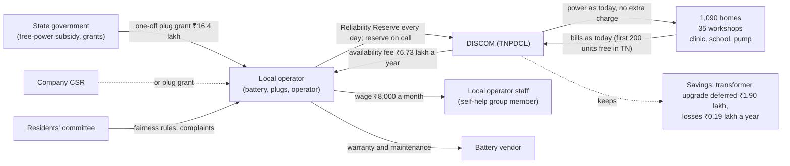

# Who owns GridSetu, who runs it, who pays

This answers the challenge's deliverable on ownership, operations, maintenance and unit
economics for one feeder. The numbers are computed by `python -m gridsetu ownership`
(`outputs/economics/ownership.json`) from the business case and the low-voltage study. Inputs
are tagged SOURCED or ASSUMED in `src/gridsetu/ownership.py`. Not legally reviewed.

## Is it allowed?

Yes. The Electricity (Amendment) Rules, 2025 (notified September 2025) let a distribution
licensee, an independent energy storage service provider or a consumer develop, own, lease or
operate an energy storage system, and let the owner sell, lease or rent its capacity, in whole
or in part, to a DISCOM or any other person.

## Three ways to own it

| | A. DISCOM owns it | B. Community cooperative owns it | C. DISCOM buys it as a service from a local operator (recommended) |
|---|---|---|---|
| Who owns the battery | DISCOM, as regulated capital spending | A residents' cooperative or self-help-group federation, with grant capital | A local operator (a small energy-service company or a cooperative) |
| Who pays | All consumers, through the tariff | Members' fees, plus grants | The DISCOM, a fixed monthly availability fee for a reliability service |
| Strength | Simplest contract | Strongest local ownership | Same contract form as India's 2025 utility battery tenders (₹ per MW per month); the operator is paid only when the battery is available; risk sits with the party that can manage it |
| Weakness | DISCOM capital and staff are stretched; slow | Low-income members cannot fund it; no one to sue if it fails | Needs a model contract and a performance check (GridSetu's reserve data provides it) |

**We recommend C**, with the residents' committee as part of it.

## Who does what (model C)

| Party | Role |
|---|---|
| **DISCOM** (for example TNPDCL) | Signs a 10-year reliability-service contract; pays the availability fee; receives the day-ahead Reliability Reserve in its ADMS; can call the reserve; sets the lifeline limit through the smart meters |
| **Local operator** | Owns or leases the battery; employs a trained local operator, for example a member of a women's self-help group: daily checks, first-line faults, the residents' help desk; meets an availability target (for example 95%) |
| **Battery vendor** | Warranty and annual maintenance contract (capacity test, thermal scan, firmware, cell replacement) |
| **Residents' committee** (resident welfare association or ward committee) | Agrees the fairness rules (who is paused, how often, override limits); hears complaints; sees the fairness ledger every month |
| **GridSetu platform** | Forecasts, the reserve, the fairness ledger, the dashboard; a software fee is inside the controller and comms cost |
| **Homes** | Nothing to pay; may override a pause; get a 200 W lifeline instead of a blackout |
| **Workshops** (Tier 2) | Agree to be curtailed second, before homes go to lifeline |

## What it costs and who pays (one feeder, 1,090 homes)

| Cost per year | ₹ | Paid by |
|---|--:|---|
| Battery service (200 kWh / 100 kW at twice the 2025 utility benchmark) | 5.52 lakh | DISCOM availability fee |
| Edge controller, comms, platform | 0.25 lakh | DISCOM availability fee |
| Local operator (₹8,000 a month, assumed) | 0.96 lakh | DISCOM availability fee |
| Smart plugs (₹1,500 a home, 5-year life) | 3.27 lakh (₹16.4 lakh one-off) | One-off grant: state scheme or company CSR |
| **Total** | **₹10.0 lakh**, ₹76.5 per home per month | |
| Extra charge to homes | **₹0** | |

**What the DISCOM gets back each year**

| | ₹ |
|---|--:|
| A transformer upgrade put off: augmenting 315 kVA to 630 kVA costs ₹20.0 lakh (MSEDCL activity rate); deferring it is worth 9.5% of that a year | 1.90 lakh |
| Technical losses avoided with the battery split across the circuits (4,665 kWh at ₹4.00) | 0.19 lakh |
| **DISCOM net cost** | **4.64 lakh** |

That is **₹8.92 for each kWh of outage avoided**. For scale, the exchange's price ceiling is
₹10/kWh, and in our real IEX week the evening hit it on 6 of 7 days, so a kWh at those hours was
worth at least that. (The community's own value of an avoided outage is higher: about ₹33/kWh
against diesel backup.)

**Is it affordable for low-income homes?** They pay nothing extra. For comparison, Tamil Nadu in
May 2026 raised free domestic power from 100 to 200 units per bill, adding about ₹1,730 crore a
year in subsidy for 1.46 crore consumers: about ₹99 per home per month. GridSetu's whole cost,
₹76.5 per home per month, is less than that, and it buys reliability rather than units.

**Grants.** The Ministry of Power's viability gap funding gives ₹18 lakh per MWh of battery
storage (June 2025, 30 GWh). It is meant for grid-scale tenders; a state aggregating many
community batteries into one tender could claim about ₹3.6 lakh per 200 kWh battery.

## Money flow

## Operations and maintenance

| How often | What | Who |
|---|---|---|
| Continuous | Remote monitoring, alarms, the day-ahead reserve | GridSetu platform |
| Daily | Walk-round: enclosure, cooling, alarms; help desk | Local operator |
| Monthly | Clean filters, check earthing and fire system; fairness ledger to the residents' committee | Local operator |
| Quarterly | Thermal scan, firmware, smart-plug check | Battery vendor and operator |
| Yearly | Capacity test; replace failed plugs | Battery vendor |
| Year 5 | Replace the smart plugs | Local operator, from the plug fund |
| Year 8–10 | Battery capacity top-up or replacement (inside the availability fee) | Battery vendor |

**Training.** One trained local operator per feeder, plus one backup. Skills: battery safety,
first-line faults, explaining a pause to a resident.

## Open questions

- Model contract between DISCOM and operator: availability target, penalty, how the reserve is
  tested. Needs DISCOM and regulator input.
- The cost of the recommended grid-forming inverter and static transfer switch (islanding study)
  is not yet in the numbers.
- Whether the 2× community premium on the battery benchmark holds for 200 kWh units.
- Legal review of the cooperative option.

Sources: Electricity (Amendment) Rules, 2025 (Saur Energy summary, September 2025); MSEDCL
activity rates (November 2024); DT Next, 10 May 2026 and Mercom, 28 May 2026 (Tamil Nadu free
power); Mercom, 10 June 2025 (viability gap funding); IEEFA–JMK via ESS News (battery benchmark).
